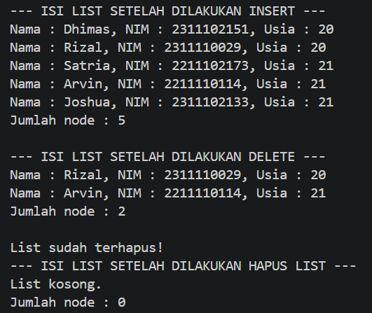
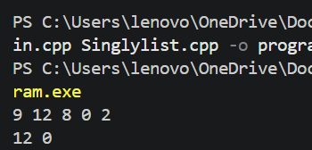

# <h1 align="center">Laporan Praktikum Modul 4 SINGLY LINKED LIST (BAGIAN PERTAMA)  </h1>
<p align="center">Irfan Ali Wicaksono - 109082500133</p>

## Dasar Teori
Linked list (biasa disebut list saja) adalah salah satu bentuk struktur data (representasi penyimpanan) berupa serangkaian elemen data yang saling berkait (berhubungan) dan bersifat fleksibel karena dapat tumbuh dan mengerut sesuai kebutuhan. Data yang disimpan dalam Linked list bisa berupa data tunggal atau data majemuk. Data tunggal merupakan data yang hanya terdiri dari satu data (variabel), misalnya: nama bertipe string. Sedangkan data majemuk  merupakan sekumpulan data (record) yang di dalamnya terdiri dari berbagai tipe data, misalnya: Data Mahasiswa, terdiri dari Nama bertipe string, NIM bertipe long integer, dan Alamat bertipe string.  

### A. ABSTRACT Linked List & Pointer  <br/>

#### 1. Pengertian Linked List & Pointer
Linked List: Structure data linear yang terdiri dari serangkaian elemen (node) yang saling berkait secara fleksibel sehingga ukurannya dapat bertambah atau berkurang secara dinamis sesuai kebutuhan

Penggunaan Pointer: Linked list diimplementasikan menggunakan pointer karena bersifat dinamis. Hal ini berbeda dengan array yang bersifat statis dan alokasi memori maksimaunnya harus ditentukan sejak awal

#### 2. Komponen Singly Linked List
- Data / Info: Informasi utama yang disimpan di dalam elemen/node.

- Successor / Next: Pointer penunjuk alamat memori node berikutnya.

- NULL / Nil: Penanda akhir dari list (node terakhir menunjuk ke Nil) atau kondisi saat list kosong.


### B.Operasi-Operasi Dasar (Primitif ADT List)

- Inisialisasi & Pengecekan: createList untuk membuat list kosong (first = Nil) dan isEmpty untuk mengecek apakah list tidak memiliki elemen.

- Manajemen Memori: alokasi untuk membuat node baru di memori dinamis (new) dan dealokasi untuk membebaskan memori node yang dihapus (delete).

- Penyisipan (Insert): Menambahkan node baru ke dalam list, bisa di awal (insertFirst), di akhir (insertLast), atau setelah node tertentu (insertAfter).

- Penghapusan (Delete): Mengeluarkan node dari list, bisa di awal (delFirst), di akhir (delLast), setelah node tertentu (delAfter), atau menghapus seluruh isi list (deleteList/delAll).

- Penelusuran (Traversing/View): Mengunjungi setiap node satu per satu dari first sampai Nil untuk menampilkan isi data (printInfo/printList) atau menghitung total node (nbList).

## Guided 

### 1. list.h

```C++
//hear guard digunakan untuk mencegah file header yg sama 
//di-include lebih dari sekali dalam 1 program
#ifndef LIST_H
#define LIST_H
#define Nil NULL

#include<iostream>
using namespace std;

//deklarasi isi data struct mahasiswa
struct mahasiswa {
    string nama;
    string nim;
    int umur;
};

typedef mahasiswa dataMahasiswa; //memberikan nama alias dataMahasiswa untuk struct mahasiswa

typedef struct node *address; //mendefinisikan alias address sebagai pointer ke struct node

struct node { //node untuk isi dari linked listnya, isis setiap node adalah data & pointer next
    dataMahasiswa isidata;
    address next;
};

struct linkedList { //ini linked listnya
    address first;
};

//semua function & prosedure yang akan dipakai
bool isEmpty(linkedList List);
void createList(linkedList &List);
address alokasi(string nama, string nim, int umur);
void dealokasi(address &node);
void printList(linkedList &List);
void insertFirst(linkedList &List, address nodeBaru);
void insertAfter(linkedList &List, address nodeBaru, address Prev);
void insertLast(linkedList &List, address nodeBaru);

void delFirst(linkedList &List);
void delLast(linkedList &List);
void delAfter(linkedList &List, address nodeHapus, address nodePrev);
int nblist(linkedList List);
void deleteList(linkedList &List);

#endif


```


### 2. list.cpp

```C++
#include "list.h"
#include <iostream>
using namespace std;

// I.S -> Initial State / kondisi awal
// F.S -> Final State / kondisi akhir

// fungsi untuk cek apakah list kosong atau tidak
bool isEmpty(linkedList List) {
    if(List.first == Nil) {
        return true;
    } else {
        return false;
    }
}

// pembuatan linked list kosong
void createList(linkedList &List) {
    /* I.S. sembarang
       F.S. terbentuk list kosong */
    List.first = Nil;
}

// pembuatan node baru dengan menerapkan manajemen memori
address alokasi(string nama, string nim, int umur) {
    /* I.S. sembarang
       F.S. mengembalikan alamat node baru dengan isidata sesuai parameter dan next = Nil */
    address nodeBaru = new node;
    nodeBaru->isidata.nama = nama;
    nodeBaru->isidata.nim = nim;
    nodeBaru->isidata.umur = umur;
    nodeBaru->next = Nil;
    return nodeBaru;
}

// penghapusan node dengan menerapkan manajemen memori
void dealokasi(address &node) {
    /* I.S. P terdefinisi
       F.S. memori yang digunakan node dikembalikan ke sistem */
    node->next = Nil;
    delete node;
}

// prosedur-prosedur untuk insert / menambahkan node baru kedalam list
void insertFirst(linkedList &List, address nodeBaru) {
    /* I.S. sembarang, P sudah dialokasikan
       F.S. menempatkan elemen list (node) pada awal list */
    nodeBaru->next = List.first;
    List.first = nodeBaru;
}

void insertAfter(linkedList &List, address nodeBaru, address nodePrev) {
    /* I.S. nodePrev pasti ada di dalam list, nodeBaru sudah dialokasikan
       F.S. menempatkan elemen list (nodeBaru) setelah nodePrev */
    if (nodePrev != Nil && nodeBaru != Nil) {
        nodeBaru->next = nodePrev->next;
        nodePrev->next = nodeBaru;
    }
}

void insertLast(linkedList &List, address nodeBaru) {
    /* I.S. sembarang, nodeBaru sudah dialokasikan
       F.S. menempatkan elemen list (nodeBaru) pada akhir list */
    if (nodeBaru != Nil) {
        if (isEmpty(List)) {
            insertFirst(List, nodeBaru);
        } else {
            address P = List.first;
            while (P->next != Nil) {
                P = P->next;
            }
            P->next = nodeBaru;
        }
    }
}

void delFirst(linkedList &List) {
    /* I.S. list tidak kosong
       F.S. node pertama di list terhapus */
    if (!isEmpty(List)) {
        address nodeHapus = List.first;
        List.first = List.first->next;
        dealokasi(nodeHapus);
    } else {
        cout << "List kosong" << endl;
    }
}

void delLast(linkedList &List){
    /* I.S. list tidak kosong
       F.S. node terakhir di list terhapus */
    address nodeHapus, nodePrev;
    if(isEmpty(List) == false){
        nodeHapus = List.first;
        if(nodeHapus->next == Nil){
            List.first = Nil;
            dealokasi(nodeHapus);
        } else {
            while(nodeHapus->next != Nil){
                nodePrev = nodeHapus;
                nodeHapus = nodeHapus->next;
            }
            nodePrev->next = Nil;
            dealokasi(nodeHapus);
        }
    } else {
        cout << "List kosong" << endl;
    }
}

void delAfter(linkedList &List, address nodeHapus, address nodePrev){
    /* I.S. list tidak kosong, Prev alamat salah satu elemen list
       F.S. nodeBantu adalah alamat dari Prev->next, menghapus Prev->next dari list */
    if(isEmpty(List) == true){
        cout << "List kosong!" << endl;
    } else {
        if (nodePrev != Nil && nodePrev->next != Nil) {
            nodeHapus = nodePrev->next;
            nodePrev->next = nodeHapus->next;
            dealokasi(nodeHapus);
        } else {
            cout << "Node sebelumnya (prev) tidak valid!" << endl;
        }
    }
}

//prosedur untuk menampilkan isi list
void printList(linkedList &List) {
    /* I.S. list mungkin kosong
       F.S. jika list tidak kosong menampilkan semua info yang ada pada list */
    if (isEmpty(List)) {
        cout << "List kosong." << endl;
    } else {
        address nodeBantu = List.first;
        while (nodeBantu != Nil) {
            cout << "Nama : " << nodeBantu->isidata.nama << ", NIM : " << nodeBantu->isidata.nim << ", Usia : " << nodeBantu->isidata.umur << endl;
            nodeBantu = nodeBantu->next;
        }
    }
}

//function untuk menampilkan jumlah node didalam list
int nblist(linkedList List) {
    /* I.S. list sudah ada
       F.S. menampilkan jumlah node didalam list */
    int count = 0;
    address nodeBantu = List.first;
    while (nodeBantu != Nil) {
        count++;
        nodeBantu = nodeBantu->next;
    }
    return count;
}

//prosedur untuk menghapus list (menghapus semua node didalam list)
void deleteList(linkedList &List) {
    /* I.S. list sudah ada
       F.S. menghapus semua node didalam list */
    address nodeBantu, nodeHapus;
    nodeBantu = List.first;
    while (nodeBantu != Nil) {
        nodeHapus = nodeBantu;
        nodeBantu = nodeBantu->next;
        dealokasi(nodeHapus);
    }
    List.first = Nil;
    cout << "List sudah terhapus!" << endl;
}

  
```

### 3. main.cpp

```C++
#include "list.h"

#include <iostream>
using namespace std;

int main(){
    linkedList List;
    address nodeA, nodeB, nodeC, nodeD, nodeE = Nil;
    createList(List);

    dataMahasiswa mhs;

    nodeA = alokasi("Dhimas", "2311102151", 20);
    nodeB = alokasi("Arvin", "2211110114", 21);
    nodeC = alokasi("Rizal", "2311110029", 20);
    nodeD = alokasi("Satria", "2211102173", 21);
    nodeE = alokasi("Joshua", "2311102133", 21);

    insertFirst(List, nodeA);
    insertLast(List, nodeB);
    insertAfter(List, nodeC, nodeA);
    insertAfter(List, nodeD, nodeC);
    insertLast(List, nodeE);

    cout << "--- ISI LIST SETELAH DILAKUKAN INSERT ---" << endl;
    printList(List);
    cout << "Jumlah node : " << nblist(List) << endl;
    cout << endl;

    delFirst(List);
    delLast(List);
    delAfter(List, nodeD, nodeC);

    cout << "--- ISI LIST SETELAH DILAKUKAN DELETE ---" << endl;
    printList(List);
    cout << "Jumlah node : " << nblist(List) << endl;
    cout << endl;

    deleteList(List);
    cout << "--- ISI LIST SETELAH DILAKUKAN HAPUS LIST ---" << endl;
    printList(List);
    cout << "Jumlah node : " << nblist(List) << endl;
    cout << endl;

    return 0;
}

```
### Output guided 1 :

##### Output 1


penjelasan singkat guided 1
Program ini mengimplementasikan struktur data Singly Linked List untuk mengelola data mahasiswa melalui operasi alokasi memori, penambahan (insert), penghapusan (delete), serta pembersihan seluruh isi list.

## Unguided 

### 1. singlylist.h 

```C++
#ifndef SINGLYLIST_H
#ifndef NULL
#define NULL 0
#endif

typedef int infotype;
typedef struct ElmList *address;

struct ElmList {
    infotype info;
    address next;
};

struct List {
    address First;
};

#define Nil NULL
#define Info(P) (P)->info
#define Next(P) (P)->next
#define First(L) ((L).First)

void createList(List &L);
address alokasi(infotype x);
void dealokasi(address P);
void printInfo(List L);
void insertFirst(List &L, address P);

// Fungsi & Prosedur Tambahan untuk Soal 2
void deleteFirst(List &L, address &P);
void deleteLast(List &L, address &P);
void deleteAfter(address Prec, address &P);
int nbList(List L);
void deleteList(List &L);

#endif
```

### 2. singlylist.cpp

```C++
#include <iostream>
#include "Singlylist.h"
using namespace std;

void createList(List &L) {
    First(L) = Nil;
}

address alokasi(infotype x) {
    address P = new ElmList;
    if (P != Nil) {
        Info(P) = x;
        Next(P) = Nil;
    }
    return P;
}

void dealokasi(address P) {
    delete P;
}

void printInfo(List L) {
    address P = First(L);
    while (P != Nil) {
        cout << Info(P) << " ";
        P = Next(P);
    }
    cout << endl;
}

void insertFirst(List &L, address P) {
    if (P != Nil) {
        Next(P) = First(L);
        First(L) = P;
    }
}

void deleteFirst(List &L, address &P) {
    if (First(L) != Nil) {
        P = First(L);
        First(L) = Next(First(L));
        Next(P) = Nil;
    } else {
        P = Nil;
    }
}

void deleteLast(List &L, address &P) {
    if (First(L) != Nil) {
        address Last = First(L);
        address Prec = Nil;
        while (Next(Last) != Nil) {
            Prec = Last;
            Last = Next(Last);
        }
        P = Last;
        if (Prec == Nil) {
            First(L) = Nil;
        } else {
            Next(Prec) = Nil;
        }
    } else {
        P = Nil;
    }
}

void deleteAfter(address Prec, address &P) {
    if (Prec != Nil && Next(Prec) != Nil) {
        P = Next(Prec);
        Next(Prec) = Next(P);
        Next(P) = Nil;
    } else {
        P = Nil;
    }
}

int nbList(List L) {
    int count = 0;
    address P = First(L);
    while (P != Nil) {
        count++;
        P = Next(P);
    }
    return count;
}

void deleteList(List &L) {
    address P;
    while (First(L) != Nil) {
        deleteFirst(L, P);
        dealokasi(P);
    }
    cout << "- List Berhasil Terhapus -" << endl;
}
```

### 3. main.cpp

```C++
#include <iostream>
#include "Singlylist.h"
using namespace std;

int main() {
    List L;
    address P1, P2, P3, P4, P5 = Nil;
    address PDel;

   
    createList(L);

    P1 = alokasi(2);
    insertFirst(L, P1);

    P2 = alokasi(0);
    insertFirst(L, P2);

    P3 = alokasi(8);
    insertFirst(L, P3);

    P4 = alokasi(12);
    insertFirst(L, P4);

    P5 = alokasi(9);
    insertFirst(L, P5);

    printInfo(L); 

    deleteFirst(L, PDel);
    dealokasi(PDel);

    
    deleteLast(L, PDel);
    dealokasi(PDel);

    deleteAfter(First(L), PDel);
    dealokasi(PDel);

    printInfo(L);
    cout << "Jumlah node : " << nbList(L) << endl << endl;

    deleteList(L);
    cout << "Jumlah node : " << nbList(L) << endl;

    return 0;
}
```
### Output Unguided 1 :

##### Output 1


penjelasan unguided 1 
Program membuat Singly Linked List baru dan menyisipkan angka 2, 0, 8, 12, lalu 9 di posisi paling depan menggunakan insertFirst() sehingga menghasilkan urutan data 9 12 8 0 2.


### Output Unguided 1 :

##### Output 1


penjelasan unguided 2 
Program menghapus angka 9 dari depan (deleteFirst), angka 2 dari belakang (deleteLast), dan angka 8 dari posisi setelah angka 12 (deleteAfter), sehingga menyisakan data 12 0 dengan jumlah 2 node. Setelah itu, seluruh isi list dihapus menggunakan deleteList() hingga list kosong dan jumlah node menjadi 0.

## Kesimpulan
Pada praktikum Modul 4 ini, dapat disimpulkan bahwa Singly Linked List merupakan struktur data linier berbasis pointer yang alokasi memorinya bersifat dinamis. Melalui praktikum ini, kita telah memahami implementasi ADT Singly Linked List beserta operasi-operasi dasarnya, seperti pembuatan list (createList), alokasi dan dealokasi memori, penyisipan elemen (insertFirst, insertLast, insertAfter), penghapusan elemen (delFirst, delLast, delAfter), penelusuran (printInfo/printList), hingga pembersihan seluruh node (deleteList). Penerapan alokasi memori dinamis membuat pengelolaan data menjadi lebih fleksibel dibandingkan array statis.
## Referensi
[1] Triase. (2020). Diktat Edisi Revisi : STRUKTUR DATA. Medan: UNIVERSTAS ISLAM NEGERI SUMATERA UTARA MEDAN. 
<br>[2] Indahyati, Uce., Rahmawati Yunianita. (2020). "BUKU AJAR ALGORITMA DAN PEMROGRAMAN DALAM BAHASA C++". Sidoarjo: Umsida Press. Diakses pada 10 Maret 2024 melalui https://doi.org/10.21070/2020/978-623-6833-67-4.
<br>...
