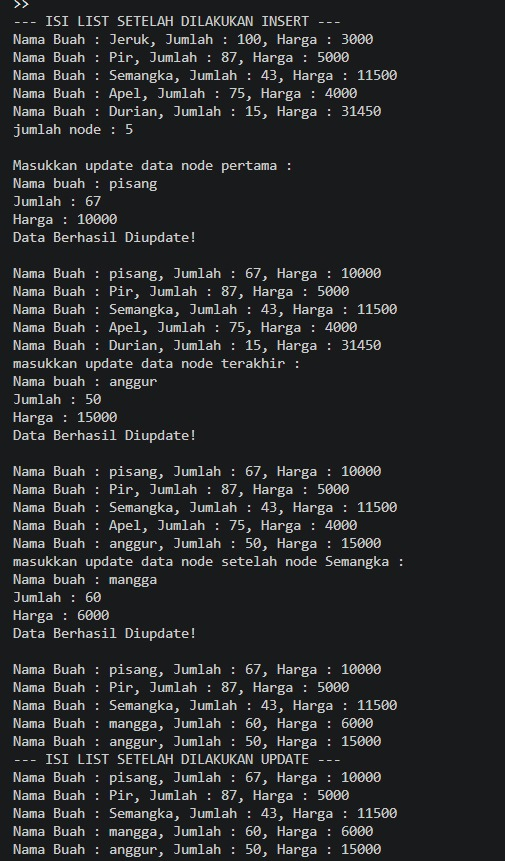
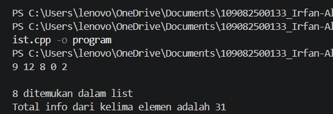

# <h1 align="center">Laporan Praktikum Modul 5 SINGLY LINKED LIST (BAGIAN KEDUA)   </h1>
<p align="center">Irfan Ali Wicaksono - 109082500133</p>

## Dasar Teori
Linked list (biasa disebut list saja) adalah salah satu bentuk struktur data berupa serangkaian elemen data yang saling berkait (berhubungan) dan bersifat dinamis, di mana ukuran atau jumlah elemennya dapat bertambah atau berkurang sewaktu-waktu sesuai kebutuhan. Setiap elemen pada linked list dihubungkan menggunakan pointer.  

### A. Konsep Singly Linked List & Pointer  <br/>

#### 1. Pengertian Singly Linked List & Pointer
Linked List: Struktur data linier yang terdiri dari sekumpulan node yang saling terhubung secara terurut melalui pointer, sehingga tidak memerlukan alokasi memori yang bersebelahan secara fisik.

Penggunaan Pointer: Linked list diimplementasikan menggunakan pointer untuk menunjukkan alamat memori dari node berikutnya, menjadikannya sangat fleksibel dibandingkan array yang bersifat statis.

#### 2. Komponen Singly Linked List
- Data / Info: Bagian dari node yang berfungsi untuk menyimpan nilai atau informasi utama (misalnya bertipe integer).

- Successor / Next: Pointer penunjuk yang menyimpan alamat memori dari node selanjutnya di dalam list.

- NULL / Nil: Penanda yang menyatakan akhir dari sebuah list (node terakhir menunjuk ke Nil) atau menunjukkan kondisi bahwa list sedang dalam keadaan kosong.


### B.Operasi-Operasi Dasar (Primitif ADT List)

- Inisialisasi & Pengecekan: createList untuk membentuk list kosong (first = Nil) dan ListEmpty untuk memeriksa apakah suatu list tidak memiliki elemen.

- Manajemen Memori: alokasi untuk memesan memori dinamis bagi node baru dan dealokasi untuk mengembalikan memori yang sudah tidak terpakai kembali ke sistem.

- Penambahan (Insert): Operasi untuk menyisipkan node baru ke dalam list, yang dapat dilakukan di awal list (insertFirst), di akhir list (insertLast), atau setelah node tertentu (insertAfter).

- Pencarian (Searching): Operasi dasar untuk mencari node tertentu di dalam list (seperti findElm atau findBefore) dengan cara menelusuri setiap node sampai data yang dicari ditemukan.

- Penghapusan (Delete): Operasi untuk membuang node dari list sekaligus merebut kembali memorinya, yang mencakup penghapusan di awal (delFirst), di akhir (delLast), setelah node tertentu (delAfter), maupun berdasarkan nilai tertentu (delP).

## Guided 

### 1. listbuah.h

```C++
//Header guard digunakan untuk mencegah file header yang sama 
  //di-include lebih dari sekali dalam satu program.
  #ifndef LISTBUAH_H
  #define LISTBUAH_H
  #define Nil NULL

  #include<iostream>
  using namespace std;

  struct buah{
      string nama;
      int jumlah; 
      float harga;
  };

  typedef buah dataBuah; //Memberikan nama alias databuah untuk struct buah.

  typedef struct node *address; //Mendefinisikan alias address sebagai pointer ke struct node

  struct node{ // node untuk isi dari linked listnya, isi setiap node adalah data & pointer next
      dataBuah isidata;
      address next;
  };

  struct linkedlist{ //ini linked list nya
      address first;
  };

  //semua function & prosedur yang akan dipakai
  //Materi modul 4
  bool isEmpty(linkedlist List);
  void createList(linkedlist &List);
  address alokasi(string nama, int jumlah, float harga);
  void dealokasi(address &node);
  void printList(linkedlist List);
  void insertFirst(linkedlist &List, address nodeBaru);
  void insertAfter(linkedlist &List, address nodeBaru, address Prev);
  void insertLast(linkedlist &List, address nodeBaru);
  void delFirst(linkedlist &List);
  void delLast(linkedlist &List);
  void delAfter(linkedlist &List, address nodeHapus, address nodePrev);
  int nbList(linkedlist List);
  void deleteList(linkedlist &List);

  //materi modul 5 (update)
  void updateFirst(linkedlist List);
  void updateLast(linkedlist List);
  void updateAfter(linkedlist List, address prev);

  //materi modul 5 (searching)
  void FindNodeByData(linkedlist list, string data);
  void FindNodeByAddress(linkedlist list, address node);
  void FindNodeByRange(linkedlist list, float hargaAwal, float HargaAkhir);

  #endif

```


### 2. listbuah.cpp

```C++
#include "listBuah.h"
#include <iostream>

using namespace std;

// fungsi untuk cek apakah list kosong atau tidak
bool isEmpty(linkedlist List) {
    if(List.first == Nil){
        return true;
    } else {
        return false;
    }
}

// pembuatan linked list kosong
void createList(linkedlist &List) {
    List.first = Nil;
}

// pembuatan node baru dengan menerapkan manajemen memori
address alokasi(string nama, int jumlah, float harga) {
    address nodeBaru = new node;
    nodeBaru->isidata.nama = nama;
    nodeBaru->isidata.jumlah = jumlah;
    nodeBaru->isidata.harga = harga;
    nodeBaru->next = Nil;
    return nodeBaru;
}

// penghapusan node dengan menerapkan manajemen memori
void dealokasi(address &node) {
    node->next = Nil;
    delete node;
}

// prosedur-prosedur untuk insert / menambahkan node baru kedalam list
void insertFirst(linkedlist &List, address nodeBaru) {
    nodeBaru->next = List.first;
    List.first = nodeBaru;
}

void insertAfter(linkedlist &List, address nodeBaru, address Prev) {
    if (Prev != Nil) {
        nodeBaru->next = Prev->next;
        Prev->next = nodeBaru;
    } else {
        cout << "Node sebelumnya tidak valid!" << endl;
    }
}

void insertLast(linkedlist &List, address nodeBaru) {
    if (isEmpty(List)) {
        List.first = nodeBaru;
    } else {
        address nodeBantu = List.first;
        while (nodeBantu->next != Nil) {
            nodeBantu = nodeBantu->next;
        }
        nodeBantu->next = nodeBaru;
    }
}

// prosedur-prosedur untuk delete / menghapus node yang ada didalam list
void delFirst(linkedlist &List){
    address nodeHapus;
    if (isEmpty(List) == false) {
        nodeHapus = List.first;
        List.first = List.first->next;
        nodeHapus->next = Nil;
        dealokasi(nodeHapus);
        cout << "Node pertama berhasil terhapus!" << endl;
    } else {
        cout << "List kosong!" << endl;
    }
}

void delLast(linkedlist &List){
    address nodeHapus, nodePrev;
    if(isEmpty(List) == false){
        nodeHapus = List.first;
        if(nodeHapus->next == Nil){
            List.first = Nil;
            dealokasi(nodeHapus);
        } else {
            while(nodeHapus->next != Nil){
                nodePrev = nodeHapus;
                nodeHapus = nodeHapus->next;
            }
            nodePrev->next = Nil;
            dealokasi(nodeHapus);
        }
        cout << "Node terakhir berhasil terhapus!" << endl;
    } else {
        cout << "list kosong" << endl;
    }
}

void delAfter(linkedlist &List, address nodeHapus, address nodePrev){
    if(isEmpty(List) == true){
        cout << "List kosong!" << endl;
    } else {
        if (nodePrev != Nil && nodePrev->next != Nil) {
            nodeHapus = nodePrev->next;
            nodePrev->next = nodeHapus->next;
            nodeHapus->next = Nil;
            dealokasi(nodeHapus);
            cout << "Node setelah node " << nodePrev->isidata.nama << " berhasil terhapus!" << endl;
        } else {
            cout << "Node sebelumnya (prev) tidak valid!" << endl;
        }
    }
}

// prosedur untuk menampilkan isi list
void printList(linkedlist List) {
    if (isEmpty(List)) {
        cout << "List kosong." << endl;
    } else {
        address nodeBantu = List.first;
        while (nodeBantu != Nil) {
            cout << "Nama Buah : " << nodeBantu->isidata.nama 
                 << ", Jumlah : " << nodeBantu->isidata.jumlah 
                 << ", Harga : " << nodeBantu->isidata.harga << endl;
            nodeBantu = nodeBantu->next;
        }
    }
}

// function untuk menampilkan jumlah node didalam list
int nbList(linkedlist List) {
    int count = 0;
    address nodeBantu = List.first;
    while (nodeBantu != Nil) {
        count++;
        nodeBantu = nodeBantu->next;
    }
    return count;
}

// prosedur untuk menghapus list (menghapus semua node didalam list)
void deleteList(linkedlist &List){
    address addressBantu, addressHapus;
    addressBantu = List.first;
    while(addressBantu != Nil){
        addressHapus = addressBantu;
        addressBantu = addressBantu->next;
        dealokasi(addressHapus);
    }
    List.first = Nil;
    cout << "List berhasil terhapus!" << endl;
}

/*----- UPDATE -----*/
void updateFirst(linkedlist List){
    if(isEmpty(List) == true){
        cout << "List kosong!" << endl;
    } else {
        cout << "Masukkan update data node pertama :" << endl;
        cout << "Nama buah : "; cin >> List.first->isidata.nama;
        cout << "Jumlah : "; cin >> List.first->isidata.jumlah;
        cout << "Harga : "; cin >> List.first->isidata.harga;
        cout << "Data Berhasil Diupdate!" << endl << endl;
    }
}

void updateLast(linkedlist List){
    if (isEmpty(List) == true) {
        cout << "List Kosong!" << endl;
    } else {
        address nodeBantu = List.first;
        while (nodeBantu->next != Nil) {
            nodeBantu = nodeBantu->next;
        }
        cout << "masukkan update data node terakhir :" << endl;
        cout << "Nama buah : "; cin >> nodeBantu->isidata.nama;
        cout << "Jumlah : "; cin >> nodeBantu->isidata.jumlah;
        cout << "Harga : "; cin >> nodeBantu->isidata.harga;
        cout << "Data Berhasil Diupdate!" << endl << endl;
    }
}

void updateAfter(linkedlist List, address nodePrev){
    if(isEmpty(List) == true){
        cout << "List kosong!" << endl;
    } else {
        if (nodePrev != Nil && nodePrev->next != Nil){
            address nodeBantu = nodePrev->next;
            cout << "masukkan update data node setelah node " << nodePrev->isidata.nama << " :" << endl;
            cout << "Nama buah : "; cin >> nodeBantu->isidata.nama;
            cout << "Jumlah : "; cin >> nodeBantu->isidata.jumlah;
            cout << "Harga : "; cin >> nodeBantu->isidata.harga;
            cout << "Data Berhasil Diupdate!" << endl << endl;
        } else {
            cout << "Node sebelumnya (prev) tidak valid!" << endl;
        }
    }
}

/*----- SEARCHING -----*/
void FindNodeByData(linkedlist list, string data){
    if(isEmpty(list) == true){
        cout << "List kosong!" << endl;
    } else {
        address nodeBantu = list.first;
        int posisi = 0;
        bool found = false;
        while(nodeBantu != Nil){
            posisi++;
            if(nodeBantu->isidata.nama == data){
                cout << "Data " << data << " ditemukan pada posisi ke-" << posisi << "!" << endl;
                cout << "Nama Buah : " << nodeBantu->isidata.nama 
                     << ", Jumlah : " << nodeBantu->isidata.jumlah 
                     << ", Harga : " << nodeBantu->isidata.harga << endl;
                found = true;
                break;
            }
            nodeBantu = nodeBantu->next;
        }
        if(found == false){
            cout << "Node dengan data " << data << " tidak ditemukan!" << endl;
        }
    }
    cout << endl;
}

void FindNodeByAddress(linkedlist list, address node) {
    if(isEmpty(list) == true) {
        cout << "List kosong!" << endl;
    } else {
        address nodeBantu = list.first;
        int posisi = 0;
        bool found = false;
        while (nodeBantu != Nil) {
            posisi++;
            if(nodeBantu == node) {
                cout << "Node ditemukan pada posisi ke-" << posisi << "!" << endl;
                cout << "Alamat node : " << nodeBantu << endl;
                cout << "Nama Buah : " << nodeBantu->isidata.nama 
                     << ", Jumlah : " << nodeBantu->isidata.jumlah 
                     << ", Harga : " << nodeBantu->isidata.harga << endl;
                found = true;
                break;
            }
            nodeBantu = nodeBantu->next;
        }
        if(found == false) {
            cout << "Node dengan alamat " << node << " tidak ditemukan dalam list!" << endl;
        }
    }
    cout << endl;
}

void FindNodeByRange(linkedlist list, float hargaAwal, float hargaAkhir) {
    if(isEmpty(list) == true) {
        cout << "List kosong!" << endl;
    } else {
        address nodeBantu = list.first;
        int posisi = 0;
        bool found = false;
        cout << "--- Buah dalam range harga " << hargaAwal << " - " << hargaAkhir << " ---" << endl;
        cout << "-------------------------------------------" << endl;
        while (nodeBantu != Nil) {
            posisi++;
            float harga = nodeBantu->isidata.harga;
            if(harga >= hargaAwal && harga <= hargaAkhir) {
                cout << "Data ditemukan pada posisi ke-" << posisi << " :" << endl;
                cout << "Nama Buah : " << nodeBantu->isidata.nama 
                     << ", Jumlah : " << nodeBantu->isidata.jumlah 
                     << ", Harga : " << nodeBantu->isidata.harga << endl;
                cout << "-------------------------------------------" << endl;
                found = true;
            }
            nodeBantu = nodeBantu->next;
        }
        if(found == false) {
            cout << "Tidak ada data buah dalam range harga tersebut!" << endl;
            cout << "-------------------------------------------" << endl;
        }
    }
    cout << endl;
}


  
```

### 3. main.cpp

```C++
#include "listBuah.h"
#include <iostream>

using namespace std;

int main(){
    linkedlist List;
    address nodeA, nodeB, nodeC, nodeD, nodeE = Nil;
    createList(List);

    // Alokasi data buah ke masing-masing node
    nodeA = alokasi("Jeruk", 100, 3000);
    nodeB = alokasi("Apel", 75, 4000);
    nodeC = alokasi("Pir", 87, 5000);
    nodeD = alokasi("Semangka", 43, 11500);
    nodeE = alokasi("Durian", 15, 31450);
    
    // Memasukkan node ke dalam linked list
    insertFirst(List, nodeA);
    insertLast(List, nodeB);
    insertAfter(List, nodeC, nodeA);
    insertAfter(List, nodeD, nodeC);
    insertLast(List, nodeE);

    cout << "--- ISI LIST SETELAH DILAKUKAN INSERT ---" << endl;
    printList(List);
    cout << "jumlah node : " << nbList(List) << endl;
    cout << endl;

    // Proses update data node
    updateFirst(List);
    printList(List);
    updateLast(List);
    printList(List);
    updateAfter(List, nodeD);
    printList(List);
    
    cout << "--- ISI LIST SETELAH DILAKUKAN UPDATE ---" << endl;
    printList(List);
    cout << "jumlah node : " << nbList(List) << endl;
    cout << endl;
    
    // Pencarian node
    FindNodeByData(List, "kelapa");
    FindNodeByAddress(List, nodeC);
    FindNodeByRange(List, 5000, 10000);
    
    // Penghapusan beberapa node
    delFirst(List);
    printList(List);
    delLast(List);
    printList(List);
    delAfter(List, nodeD, nodeC);
    printList(List);

    cout << "--- ISI LIST SETELAH DILAKUKAN DELETE ---" << endl;
    printList(List);
    cout << "jumlah node : " << nbList(List) << endl;
    cout << endl;

    // Mengosongkan seluruh isi list
    deleteList(List);
    cout << "--- ISI LIST SETELAH DILAKUKAN HAPUS LIST ---" << endl;
    printList(List);
    cout << "jumlah node : " << nbList(List) << endl;
    cout << endl;

    return 0;
}


```
### Output guided 1 :

##### Output 1


penjelasan singkat guided 1
Program tersebut menampilkan proses pembaruan data (*update*) pada node pertama, node terakhir, dan node tertentu setelah node Semangka di dalam *linked list* buah, sehingga menghasilkan daftar akhir yang berisi Pisang, Pir, Semangka, Mangga, dan Anggur.

## Unguided 

### 1. singlylist.h 

```C++
#ifndef SINGLYLIST_H
#define SINGLYLIST_H

#include <iostream>

using namespace std;

#define Nil NULL
#define Info(P) (P)->info
#define Next(P) (P)->next
#define First(L) (L).first

typedef int infotype;
typedef struct elmlist *address;

struct elmlist {
    infotype info;
    address next;
};

struct List {
    address first;
};

// Prosedur dan Fungsi Dasar
void CreateList(List &L);
address alokasi(infotype x);
void dealokasi(address &P);
void printInfo(List L);
void insertFirst(List &L, address P);

// Fungsi Tambahan (Latihan No. 3 & No. 4)
address findElm(List L, infotype x);
int sumInfo(List L);

#endif
```

### 2. singlylist.cpp

```C++
#include "Singlylist.h"

// Membuat list kosong
void CreateList(List &L) {
    First(L) = Nil;
}

// Alokasi memori untuk elemen baru
address alokasi(infotype x) {
    address P = new elmlist;
    if (P != Nil) {
        Info(P) = x;
        Next(P) = Nil;
    }
    return P;
}

// Dealokasi memori elemen
void dealokasi(address &P) {
    delete P;
    P = Nil;
}

// Menampilkan seluruh info dalam list (Gambar 5-2)
void printInfo(List L) {
    address P = First(L);
    while (P != Nil) {
        cout << Info(P) << " ";
        P = Next(P);
    }
    cout << endl;
}

// Menambahkan elemen di awal list
void insertFirst(List &L, address P) {
    Next(P) = First(L);
    First(L) = P;
}

// (Latihan No. 3) Mencari elemen dengan info tertentu
address findElm(List L, infotype x) {
    address P = First(L);
    while (P != Nil) {
        if (Info(P) == x) {
            return P;
        }
        P = Next(P);
    }
    return Nil;
}

// (Latihan No. 4) Menghitung jumlah total info seluruh elemen
int sumInfo(List L) {
    int total = 0;
    address P = First(L);
    while (P != Nil) {
        total += Info(P);
        P = Next(P);
    }
    return total;
}
```

### 3. main.cpp

```C++
#include "Singlylist.h"

int main() {
    List L;
    address P1, P2, P3, P4, P5;
    
    
    CreateList(L);

    
    P1 = alokasi(2);
    insertFirst(L, P1);

    P2 = alokasi(0);
    insertFirst(L, P2);

    P3 = alokasi(8);
    insertFirst(L, P3);

    P4 = alokasi(12);
    insertFirst(L, P4);

    P5 = alokasi(9);
    insertFirst(L, P5);

    
    printInfo(L);
    cout << endl;

    
    address found = findElm(L, 8);
    if (found != Nil) {
        cout << "8 ditemukan dalam list" << endl;
    } else {
        cout << "8 tidak ditemukan dalam list" << endl;
    }

    
    int total = sumInfo(L);
    cout << "Total info dari kelima elemen adalah " << total << endl;

    return 0;
}
```
### Output Unguided 1 :

##### Output 1


penjelasan unguided 1 
Program tersebut berjalan dengan menginisialisasi dan menyisipkan elemen ke dalam Singly Linked List untuk menampilkan urutan data 9 12 8 0 2, mencari nilai 8, serta menghitung jumlah total keseluruhan elemen yang menghasilkan angka 31.


## Kesimpulan
Pada praktikum Modul 5 ini, dapat disimpulkan bahwa Singly Linked List merupakan struktur data linier berbasis pointer yang alokasi memorinya bersifat dinamis, sehingga kita dapat memahami implementasi ADT beserta operasi-operasi dasarnya seperti pencarian elemen, manajemen memori, penambahan dan penghapusan elemen, serta pemrosesan list secara fleksibel dibandingkan array statis.

## Referensi
[1] Triase. (2020). Diktat Edisi Revisi : STRUKTUR DATA. Medan: UNIVERSTAS ISLAM NEGERI SUMATERA UTARA MEDAN. 
<br>[2] Indahyati, Uce., Rahmawati Yunianita. (2020). "BUKU AJAR ALGORITMA DAN PEMROGRAMAN DALAM BAHASA C++". Sidoarjo: Umsida Press. Diakses pada 10 Maret 2024 melalui https://doi.org/10.21070/2020/978-623-6833-67-4.
<br>...
