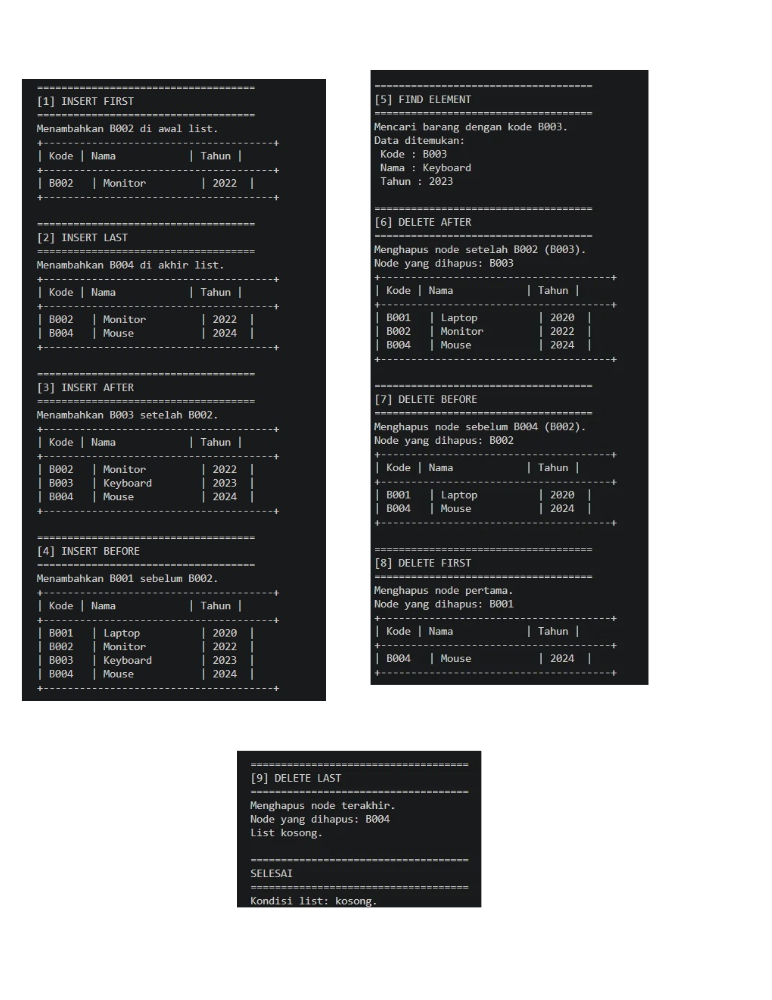
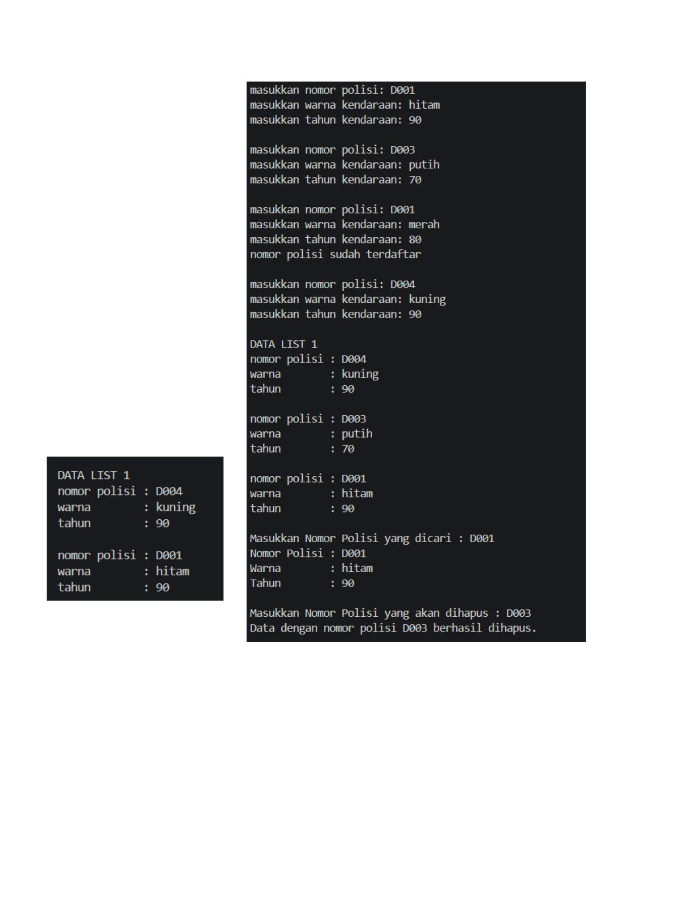

# <h1 align="center">Laporan Praktikum Modul 6  DOUBLY LINKED LIST (BAGIAN PERTAMA)    </h1>
<p align="center">Irfan Ali Wicaksono - 109082500133</p>

## Dasar Teori
Doubly Linked List adalah salah satu bentuk struktur data linier berupa serangkaian elemen data (node) yang saling berkait, di mana setiap elemennya memiliki dua buah successor, yaitu pointer next yang menunjuk ke elemen sesudahnya dan pointer prev yang menunjuk ke elemen sebelumnya.

### A. Konsep Doubly Linked List & Pointer  <br/>

#### 1. Pengertian Doubly Linked List & Pointer
Doubly Linked List: Struktur data linier yang terdiri dari sekumpulan node yang saling terhubung secara terurutan melalui dua arah (maju dan mundur), sehingga memudahkan proses penelusuran data tanpa memerlukan alokasi memori yang bersebelahan secara fisik.

Penggunaan Pointer: Doubly linked list diimplementasikan menggunakan pointer first dan last untuk menunjukkan awal dan akhir list, serta pointer next dan prev pada tiap node, menjadikannya sangat fleksibel dibandingkan array yang bersifat statis.

#### 2. Komponen Doubly Linked List
- Data / Info: Bagian dari node yang berfungsi untuk menyimpan nilai atau informasi utama (misalnya tipe data bentukan/record seperti data kendaraan).

- First: Pointer pada list yang menunjuk pada elemen pertama dari sebuah list.

- Last: Pointer pada list yang menunjuk pada elemen terakhir dari sebuah list.

- Next / Successor: Pointer penunjuk yang menyimpan alamat memori dari node selanjutnya di dalam list.

- Prev / Predecessor: Pointer penunjuk yang menyimpan alamat memori dari node sebelumnya di dalam list.

- NULL / Nil: Penanda yang menyatakan akhir dari sebuah list (node terakhir menunjuk Nil pada next) atau menunjukkan kondisi bahwa list sedang dalam keadaan kosong (L.first = Nil dan L.last = Nil).


### B. Operasi-Operasi Dasar (Primitif ADT List)

- Inisialisasi & Pengecekan: createList untuk membentuk list kosong (first = Nil dan last = Nil) serta pemeriksaan apakah suatu list tidak memiliki elemen.

- Manajemen Memori: alokasi untuk memesan memori dinamis bagi node baru dan dealokasi untuk mengembalikan memori yang sudah tidak terpakai kembali ke sistem.

- Penambahan (Insert): Operasi untuk menyisipkan node baru ke dalam list, yang dapat dilakukan di awal list (insertFirst), di akhir list (insertLast), maupun di antara node tertentu (insertAfter / insertBefore).

- Pencarian (Searching): Operasi dasar untuk mencari node tertentu di dalam list (seperti findElm) dengan cara menelusuri setiap node sampai data yang dicari ditemukan.

- Penghapusan (Delete): Operasi untuk membuang node dari list sekaligus merebut kembali memorinya, yang mencakup penghapusan di awal (delFirst), di akhir (delLast), maupun setelah/sebelum node tertentu (delAfter / delBefore).


## Guided 

### 1. doublylist.h

```C++
#ifndef DOUBLYLIST_H
#define DOUBLYLIST_H

#include <string>
using namespace std;

struct barang {
    string kode;
    string nama;
    int tahun;
};

using infotype = barang;
struct elmlist;
using address = elmlist*;

struct elmlist {
    infotype info;
    address prev;
    address next;
};

struct list {
    address first;
    address last;
};

void CreateList(list &L);
address alokasi(const infotype &x);
void dealokasi(address &P);
void insertFirst(list &L, address P);
void insertLast(list &L, address P);
void insertAfter(list &L, address R, address P);
void insertBefore(list &L, address R, address P);
void printInfo(const list &L);
address findElm(const list &L, const string &kode);
void deleteFirst(list &L, address &P);
void deleteLast(list &L, address &P);
void deleteAfter(list &L, address prec, address &P);
void deleteBefore(list &L, address succ, address &P);

#endif

```


### 2. doublylist.cpp

```C++
#include <iostream>
#include <iomanip>
#include "Doublylist.h"
using namespace std;

void CreateList(list &L) { 
    L.first = nullptr; 
    L.last = nullptr; 
}

address alokasi(const infotype &x) {
    address P = new elmlist;
    P->info = x;
    P->prev = nullptr; 
    P->next = nullptr;
    return P;
}

void dealokasi(address &P) {
    if (P != nullptr) { 
        delete P; 
        P = nullptr; 
    }
}

void insertFirst(list &L, address P) {
    if (!P) return;
    P->prev = nullptr; 
    P->next = L.first;
    if (L.first) L.first->prev = P;
    else L.last = P;
    L.first = P;
}

void insertLast(list &L, address P) {
    if (!P) return;
    P->next = nullptr; 
    P->prev = L.last;
    if (L.last) L.last->next = P;
    else L.first = P;
    L.last = P;
}

// Menyisipkan P tepat setelah R.
void insertAfter(list &L, address R, address P) {
    if (!R || !P) return;
    P->prev = R;
    P->next = R->next;
    if (R->next) R->next->prev = P;
    else L.last = P;
    R->next = P;
}

// Menyisipkan P tepat sebelum R.
void insertBefore(list &L, address R, address P) {
    if (!R || !P) return;
    P->next = R;
    P->prev = R->prev;
    if (R->prev) R->prev->next = P;
    else L.first = P;
    R->prev = P;
}

void printInfo(const list &L) {
    address P = L.first;
    if (!P) {
        cout << "List kosong.\n";
        return;
    }

    cout << "+--------------------------------------+\n";
    cout << "| Kode | Nama            | Tahun |\n";
    cout << "+--------------------------------------+\n";
    while (P) {
        cout << "| " << left << setw(6) << P->info.kode
             << " | " << setw(15) << P->info.nama
             << " | " << setw(5) << P->info.tahun << " |\n";
        P = P->next;
    }
    cout << "+--------------------------------------+\n";
}

address findElm(const list &L, const string &kode) {
    address P = L.first;
    while (P) {
        if (P->info.kode == kode) return P;
        P = P->next;
    }
    return nullptr;
}

void deleteFirst(list &L, address &P) {
    if (!L.first) { 
        P = nullptr; 
        return; 
    }
    P = L.first; 
    L.first = P->next;
    if (L.first) L.first->prev = nullptr;
    else L.last = nullptr;
    P->prev = P->next = nullptr;
}

void deleteLast(list &L, address &P) {
    if (!L.last) { 
        P = nullptr; 
        return; 
    }
    P = L.last; 
    L.last = P->prev;
    if (L.last) L.last->next = nullptr;
    else L.first = nullptr;
    P->prev = P->next = nullptr;
}

// Menghapus node tepat setelah prec.
void deleteAfter(list &L, address prec, address &P) {
    P = nullptr;
    if (!prec || !prec->next) return;
    P = prec->next; 
    prec->next = P->next;
    if (P->next) P->next->prev = prec;
    else L.last = prec;
    P->prev = P->next = nullptr;
}

// Menghapus node tepat sebelum succ.
void deleteBefore(list &L, address succ, address &P) {
    P = nullptr;
    if (!succ || !succ->prev) return;
    P = succ->prev; 
    succ->prev = P->prev;
    if (P->prev) P->prev->next = succ;
    else L.first = succ;
    P->prev = P->next = nullptr;
}   

  
```

### 3. main.cpp

```C++
#include <iostream>
#include "Doublylist.h"
using namespace std;

void tampilkanJudul(const string &judul) {
    cout << "\n====================================\n";
    cout << judul << "\n";
    cout << "====================================\n";
}

int main() {
    list L;
    CreateList(L);

    infotype barang1 = {"B001", "Laptop", 2020};
    infotype barang2 = {"B002", "Monitor", 2022};
    infotype barang3 = {"B003", "Keyboard", 2023};
    infotype barang4 = {"B004", "Mouse", 2024};

    address P = nullptr;
    address posisi = nullptr;

    cout << "DEMONSTRASI OPERASI DOUBLY LINKED LIST\n";
    cout << "Data yang digunakan: B001, B002, B003, dan B004\n";

    tampilkanJudul("[1] INSERT FIRST");
    cout << "Menambahkan B002 di awal list.\n";
    insertFirst(L, alokasi(barang2));
    printInfo(L);

    tampilkanJudul("[2] INSERT LAST");
    cout << "Menambahkan B004 di akhir list.\n";
    insertLast(L, alokasi(barang4));
    printInfo(L);

    tampilkanJudul("[3] INSERT AFTER");
    cout << "Menambahkan B003 setelah B002.\n";
    posisi = findElm(L, "B002");
    if (posisi != nullptr) {
        insertAfter(L, posisi, alokasi(barang3));
    }
    printInfo(L);

    tampilkanJudul("[4] INSERT BEFORE");
    cout << "Menambahkan B001 sebelum B002.\n";
    posisi = findElm(L, "B002");
    if (posisi != nullptr) {
        insertBefore(L, posisi, alokasi(barang1));
    }
    printInfo(L);

    tampilkanJudul("[5] FIND ELEMENT");
    cout << "Mencari barang dengan kode B003.\n";
    posisi = findElm(L, "B003");
    if (posisi != nullptr) {
        cout << "Data ditemukan:\n";
        cout << " Kode : " << posisi->info.kode << "\n";
        cout << " Nama : " << posisi->info.nama << "\n";
        cout << " Tahun : " << posisi->info.tahun << "\n";
    } else {
        cout << "Data tidak ditemukan.\n";
    }

    tampilkanJudul("[6] DELETE AFTER");
    cout << "Menghapus node setelah B002 (B003).\n";
    posisi = findElm(L, "B002");
    deleteAfter(L, posisi, P);
    if (P != nullptr) {
        cout << "Node yang dihapus: " << P->info.kode << "\n";
        dealokasi(P);
    } else {
        cout << "Tidak ada node yang dapat dihapus.\n";
    }
    printInfo(L);

    tampilkanJudul("[7] DELETE BEFORE");
    cout << "Menghapus node sebelum B004 (B002).\n";
    posisi = findElm(L, "B004");
    deleteBefore(L, posisi, P);
    if (P != nullptr) {
        cout << "Node yang dihapus: " << P->info.kode << "\n";
        dealokasi(P);
    } else {
        cout << "Tidak ada node yang dapat dihapus.\n";
    }
    printInfo(L);

    tampilkanJudul("[8] DELETE FIRST");
    cout << "Menghapus node pertama.\n";
    deleteFirst(L, P);
    if (P != nullptr) {
        cout << "Node yang dihapus: " << P->info.kode << "\n";
        dealokasi(P);
    } else {
        cout << "List kosong, tidak ada node yang dapat dihapus.\n";
    }
    printInfo(L);

    tampilkanJudul("[9] DELETE LAST");
    cout << "Menghapus node terakhir.\n";
    deleteLast(L, P);
    if (P != nullptr) {
        cout << "Node yang dihapus: " << P->info.kode << "\n";
        dealokasi(P);
    } else {
        cout << "List kosong, tidak ada node yang dapat dihapus.\n";
    }
    printInfo(L);

    tampilkanJudul("SELESAI");
    cout << "Kondisi list: "
         << (L.first == nullptr && L.last == nullptr ? "kosong.\n" : "masih berisi data.\n");

    return 0;
}


```
### Output guided 1 :

##### Output 1


penjelasan singkat guided 1
Program di atas menggunakan struktur data double linked list untuk mengelola data barang, yang dibagi menjadi tiga file utama agar terstruktur secara modular: file header (doublylist.h) untuk mendeklarasikan struktur node, infotype, dan prototipe fungsi; file implementasi (doublylist.cpp) untuk mendefinisikan logika fungsi seperti penambahan (insert), penghapusan (delete), pencarian (find), dan pencetakan data; serta file utama (main.cpp) untuk mengeksekusi seluruh skenario pengujian sesuai urutan operasi pada gambar.

## Unguided 

### 1. kendaraanlist.h 

```C++
#ifndef KENDARAANLIST_H
#define KENDARAANLIST_H

#include <string>
using namespace std;

struct kendaraan {
    string nopol;
    string warna;
    int thnBuat;
};

typedef kendaraan infotype;
typedef struct elmlist *address;

struct elmlist {
    infotype info;
    address next;
    address prev;
};

struct list {
    address first;
    address last;
};

// Prototipe Primitif ADT Doubly Linked List
void createList(list &L);
address alokasi(infotype x);
void dealokasi(address &P);
void insertFirst(list &L, address P);
void insertLast(list &L, address P);
address findElm(list L, string nopol);
void deleteFirst(list &L, address &P);
void deleteLast(list &L, address &P);
void deleteAfter(list &L, address Prec, address &P);
void deleteSpecific(list &L, string nopol, address &P);
void printInfo(list L);

#endif
```

### 2. kendaraanlist.cpp

```C++
#include "kendaraanlist.h"
#include <iostream>

using namespace std;

void createList(list &L) {
    L.first = nullptr;
    L.last = nullptr;
}

address alokasi(infotype x) {
    address P = new elmlist;
    P->info = x;
    P->next = nullptr;
    P->prev = nullptr;
    return P;
}

void dealokasi(address &P) {
    delete P;
    P = nullptr;
}

void insertFirst(list &L, address P) {
    if (L.first == nullptr) {
        L.first = P;
        L.last = P;
    } else {
        P->next = L.first;
        L.first->prev = P;
        L.first = P;
    }
}

void insertLast(list &L, address P) {
    if (L.first == nullptr) {
        insertFirst(L, P);
    } else {
        L.last->next = P;
        P->prev = L.last;
        L.last = P;
    }
}

address findElm(list L, string nopol) {
    address P = L.first;
    while (P != nullptr) {
        if (P->info.nopol == nopol) {
            return P;
        }
        P = P->next;
    }
    return nullptr;
}

void deleteFirst(list &L, address &P) {
    if (L.first != nullptr) {
        P = L.first;
        if (L.first == L.last) {
            L.first = nullptr;
            L.last = nullptr;
        } else {
            L.first = L.first->next;
            L.first->prev = nullptr;
            P->next = nullptr;
        }
    }
}

void deleteLast(list &L, address &P) {
    if (L.last != nullptr) {
        P = L.last;
        if (L.first == L.last) {
            deleteFirst(L, P);
        } else {
            L.last = L.last->prev;
            L.last->next = nullptr;
            P->prev = nullptr;
        }
    }
}

void deleteAfter(list &L, address Prec, address &P) {
    if (Prec != nullptr && Prec->next != nullptr) {
        P = Prec->next;
        if (P == L.last) {
            deleteLast(L, P);
        } else {
            Prec->next = P->next;
            P->next->prev = Prec;
            P->next = nullptr;
            P->prev = nullptr;
        }
    }
}

void deleteSpecific(list &L, string nopol, address &P) {
    P = findElm(L, nopol);
    if (P != nullptr) {
        if (P == L.first) {
            deleteFirst(L, P);
        } else if (P == L.last) {
            deleteLast(L, P);
        } else {
            deleteAfter(L, P->prev, P);
        }
    }
}

void printInfo(list L) {
    address P = L.first;
    if (P == nullptr) {
        cout << "List kosong." << endl;
    } else {
        cout << "DATA LIST 1" << endl;
        while (P != nullptr) {
            cout << "nomor polisi : " << P->info.nopol << endl;
            cout << "warna        : " << P->info.warna << endl;
            cout << "tahun        : " << P->info.thnBuat << endl;
            cout << endl;
            P = P->next;
        }
    }
}
```

### 3. main.cpp

```C++
#include "kendaraanlist.h"
#include <iostream>

using namespace std;

int main() {
    list L;
    createList(L);
    infotype x;
    address P;
    string nopolCari, nopolHapus;

    // 1. Input data kendaraan & validasi duplikat (Sesuai Gambar 6-23)
    x = {"D001", "hitam", 90};
    cout << "masukkan nomor polisi: " << x.nopol << endl;
    cout << "masukkan warna kendaraan: " << x.warna << endl;
    cout << "masukkan tahun kendaraan: " << x.thnBuat << endl;
    if (findElm(L, x.nopol) == nullptr) {
        P = alokasi(x);
        insertFirst(L, P);
    } else {
        cout << "nomor polisi sudah terdaftar" << endl;
    }
    cout << endl;

    x = {"D003", "putih", 70};
    cout << "masukkan nomor polisi: " << x.nopol << endl;
    cout << "masukkan warna kendaraan: " << x.warna << endl;
    cout << "masukkan tahun kendaraan: " << x.thnBuat << endl;
    if (findElm(L, x.nopol) == nullptr) {
        P = alokasi(x);
        insertFirst(L, P);
    } else {
        cout << "nomor polisi sudah terdaftar" << endl;
    }
    cout << endl;

    x = {"D001", "merah", 80};
    cout << "masukkan nomor polisi: " << x.nopol << endl;
    cout << "masukkan warna kendaraan: " << x.warna << endl;
    cout << "masukkan tahun kendaraan: " << x.thnBuat << endl;
    if (findElm(L, x.nopol) == nullptr) {
        P = alokasi(x);
        insertFirst(L, P);
    } else {
        cout << "nomor polisi sudah terdaftar" << endl;
    }
    cout << endl;

    x = {"D004", "kuning", 90};
    cout << "masukkan nomor polisi: " << x.nopol << endl;
    cout << "masukkan warna kendaraan: " << x.warna << endl;
    cout << "masukkan tahun kendaraan: " << x.thnBuat << endl;
    if (findElm(L, x.nopol) == nullptr) {
        P = alokasi(x);
        insertFirst(L, P);
    } else {
        cout << "nomor polisi sudah terdaftar" << endl;
    }
    cout << endl;

    printInfo(L);

    // 2. Pencarian Elemen (Sesuai Gambar 6-24)
    nopolCari = "D001";
    cout << "Masukkan Nomor Polisi yang dicari : " << nopolCari << endl;
    address found = findElm(L, nopolCari);
    if (found != nullptr) {
        cout << "Nomor Polisi : " << found->info.nopol << endl;
        cout << "Warna        : " << found->info.warna << endl;
        cout << "Tahun        : " << found->info.thnBuat << endl;
    } else {
        cout << "Data tidak ditemukan." << endl;
    }
    cout << endl;

    // 3. Penghapusan Elemen (Sesuai Gambar 6-25)
    nopolHapus = "D003";
    cout << "Masukkan Nomor Polisi yang akan dihapus : " << nopolHapus << endl;
    deleteSpecific(L, nopolHapus, P);
    if (P != nullptr) {
        cout << "Data dengan nomor polisi " << nopolHapus << " berhasil dihapus." << endl;
        dealokasi(P);
    } else {
        cout << "Data tidak ditemukan." << endl;
    }
    cout << endl;

    printInfo(L);

    return 0;
}
```
### Output Unguided 1 :

##### Output 1


penjelasan unguided 1 
Program tersebut menampilkan simulasi program double linked list untuk mengelola data kendaraan yang mencakup proses penambahan data dengan validasi duplikat, pencetakan daftar, pencarian elemen, serta penghapusan data tertentu.


## Kesimpulan
Pada praktikum Modul 6 ini, dapat disimpulkan bahwa Doubly Linked List merupakan struktur data linier berbasis pointer yang masing-masing elemennya memiliki dua buah penunjuk (successor), yaitu next dan prev. Dengan alokasi memori yang bersifat dinamis, kita dapat memahami implementasi ADT beserta operasi dasarnya secara lebih fleksibel dibandingkan array statis, mulai dari penambahan elemen di awal atau akhir (insertFirst, insertLast), pencarian data (findElm), hingga penghapusan elemen pada posisi tertentu (deleteFirst, deleteLast, deleteAfter) secara efektif menggunakan iterasi maju maupun mundur.
## Referensi
[1] Triase. (2020). Diktat Edisi Revisi : STRUKTUR DATA. Medan: UNIVERSTAS ISLAM NEGERI SUMATERA UTARA MEDAN. 
<br>[2] Indahyati, Uce., Rahmawati Yunianita. (2020). "BUKU AJAR ALGORITMA DAN PEMROGRAMAN DALAM BAHASA C++". Sidoarjo: Umsida Press. Diakses pada 10 Maret 2024 melalui https://doi.org/10.21070/2020/978-623-6833-67-4.
<br>...
